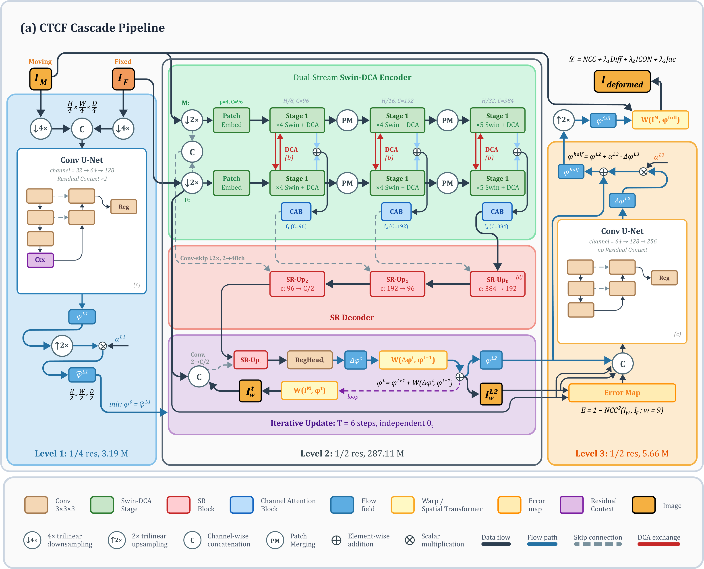
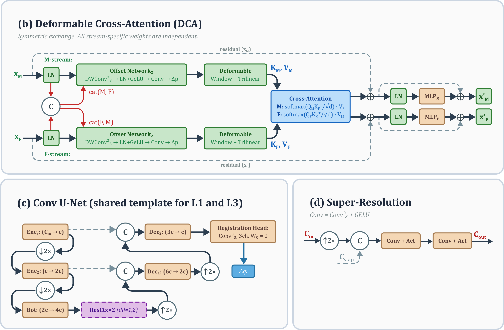
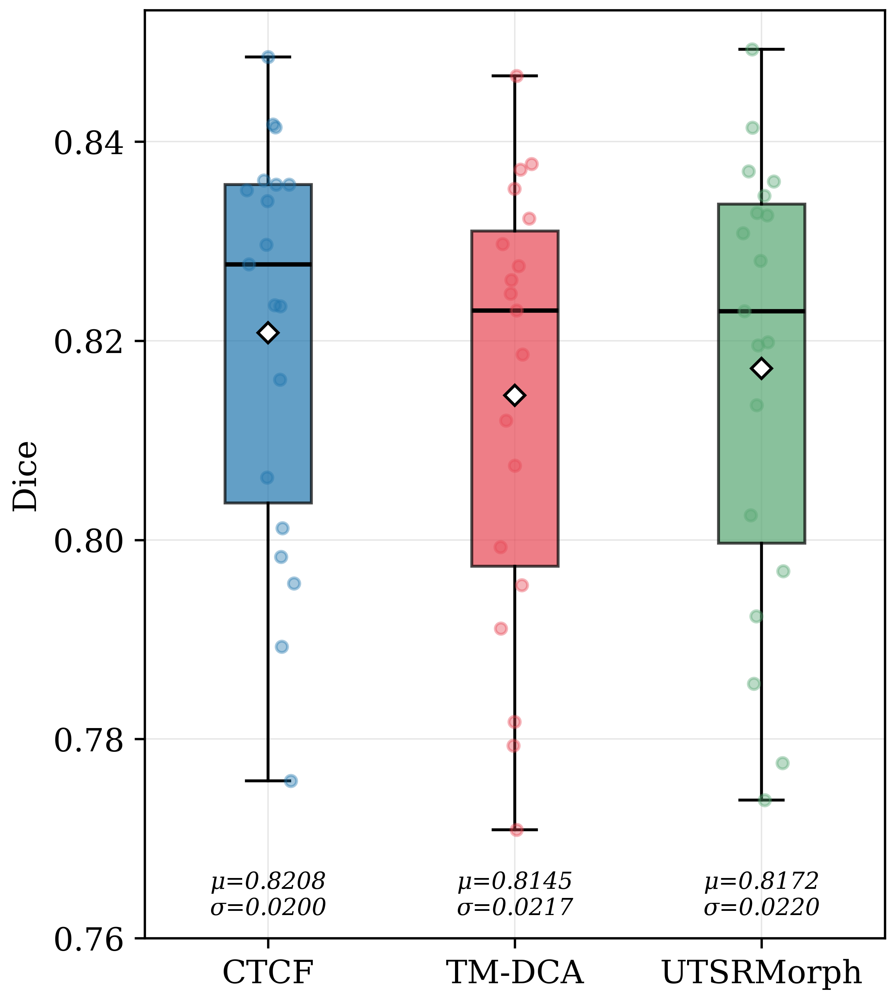
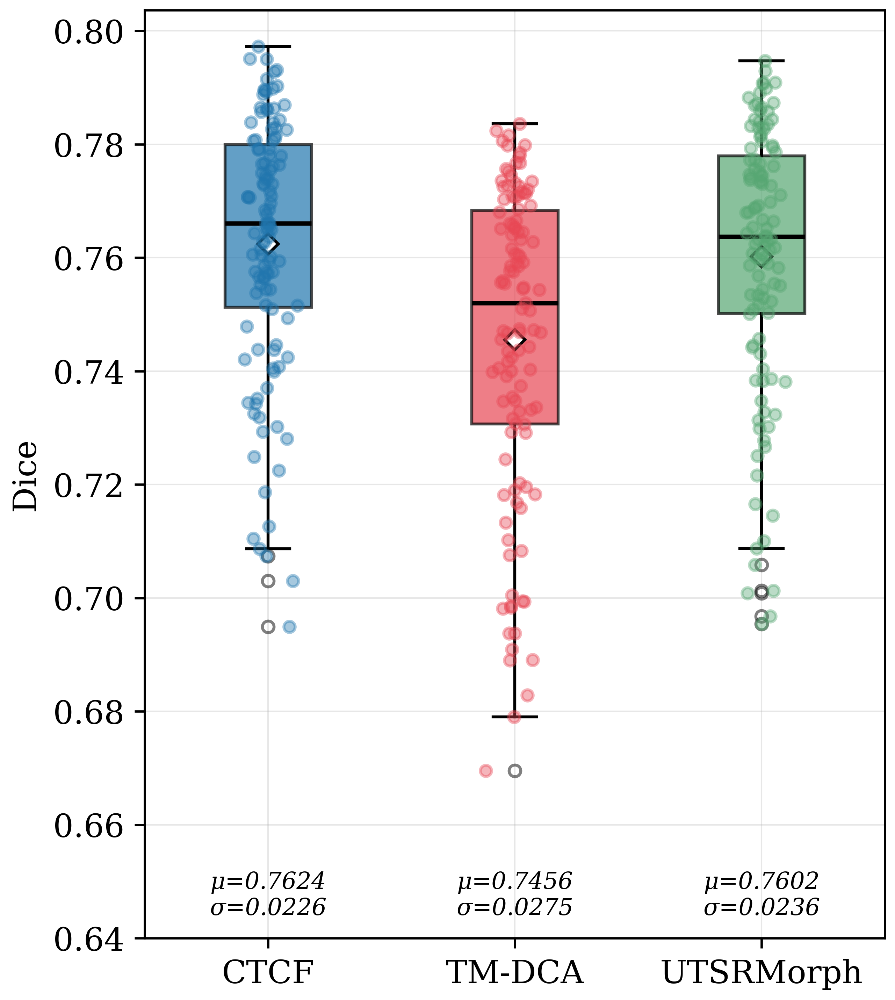

# CTCF: Cascade Transformer for Coarse-to-Fine Unsupervised Medical Image Registration

> **Status (August 2026):** The frozen source snapshot for the published CTCF paper is
> tag **v1.0**. The current tree keeps the paper training and inference entry points while
> adding backbone-pluggable models, exact topology checks, and reusable post-inference
> research utilities. The metrics below refer to the published v1.0 protocol.

A three-level coarse-to-fine cascade framework for unsupervised deformable 3D medical image registration.

**Paper (preprint):** [CTCF: A Three-Level Coarse-to-Fine Cascade for Unsupervised Deformable Medical Image Registration](https://doi.org/10.20944/preprints202604.0580.v1) — Preprints.org, 2026.

**Pretrained checkpoints:** [10.5281/zenodo.19665292](https://doi.org/10.5281/zenodo.19665292) — CTCF and both baselines on OASIS + IXI.

## Architecture

CTCF wraps a lightweight coarse-and-refine envelope around an existing single-pass registration backbone (TransMorph-DCA):

- **Level 1** — CoarseFlowNet (3.19M params): convolutional U-Net at 1/4 resolution for global alignment.
- **Level 2** — Swin-DCA + SR decoder (287.11M params): dual-stream Swin Transformer with DCA at 1/2 resolution.
- **Level 3** — FlowRefiner (5.66M params): error-driven convolutional U-Net at 1/2 resolution using NCC error maps.

Total: **295.96M** parameters. Levels 1 and 3 add only **3.0%** overhead over the TransMorph-DCA backbone.

A smoothstep warmup schedule gradually activates the outer cascade levels during training.



<details>
<summary>Building blocks</summary>


</details>

## Results

All models trained **unsupervised** (NCC + regularization, no segmentation labels during training).

### OASIS (19 test pairs)

| Method | Dice | HD95 | SDlogJ | Fold% | Params |
|--------|------|------|--------|-------|--------|
| TransMorph-DCA | 0.8145 | 1.848 | 0.0805 | 0.264 | 283.93M |
| UTSRMorph (Large) | 0.8172 | 1.890 | 0.1015 | 0.890 | 421.50M |
| **CTCF (ours)** | **0.8208** | **1.790** | **0.0797** | 0.523 | 295.96M |

### IXI (115 test subjects)

| Method | Dice | HD95 | SDlogJ | Fold% | Params |
|--------|------|------|--------|-------|--------|
| TransMorph-DCA | 0.7456 | 3.504 | 0.0874 | 1.153 | 283.93M |
| UTSRMorph (IXI-Large) | 0.7602 | 3.012 | 0.0627 | 0.677 | 152.23M |
| **CTCF (ours)** | **0.7624** | **2.843** | **0.0594** | **0.561** | 295.96M |

All Dice improvements are statistically significant (p < 0.001, Wilcoxon signed-rank test).

### Visual Comparison

| OASIS | IXI |
|:-----:|:---:|
|  |  |

### Qualitative Examples

| OASIS | IXI |
|:-----:|:---:|
|  |  |

## Installation

```bash
conda env create -f environment.yml
conda activate ctcf
```

## Datasets

Both datasets are used in their `.pkl`-format preprocessed versions
redistributed by the [TransMorph project][transmorph-repo]:

- **OASIS** — Learn2Reg 2021 Task 3 preprocessing (skull stripping, bias-field
  correction, affine alignment to MNI 152, FreeSurfer segmentation of 35
  labels). Download via TransMorph's [OASIS page][transmorph-oasis] (~1.3 GB).
- **IXI** — FreeSurfer-segmented T1 volumes (30 anatomical labels) with a
  template atlas from CycleMorph. Redistributed under CC BY-SA 3.0 Unported.
  Download via TransMorph's [IXI page][transmorph-ixi].

Both datasets come preprocessed to 160×192×224.

If you use these data, please cite:

- **OASIS:** Marcus et al., *J. Cogn. Neurosci.* 19:1498–1507 (2007);
  Hoopes et al., *IPMI 2021* (preprocessing / HyperMorph release).
- **IXI:** the IXI consortium at <https://brain-development.org/ixi-dataset/>.
- **TransMorph** (for both `.pkl` distributions): Chen et al., *Med. Image
  Anal.* 82:102615 (2022).
- **CycleMorph** (IXI atlas): Kim et al., *Med. Image Anal.* 71:102036 (2021).

[transmorph-repo]: https://github.com/junyuchen245/TransMorph_Transformer_for_Medical_Image_Registration
[transmorph-oasis]: https://github.com/junyuchen245/TransMorph_Transformer_for_Medical_Image_Registration/blob/main/OASIS/TransMorph_on_OASIS.md
[transmorph-ixi]: https://github.com/junyuchen245/TransMorph_Transformer_for_Medical_Image_Registration/blob/main/IXI/TransMorph_on_IXI.md

## Path Configuration

All training and inference scripts read dataset locations from the `PATHS` dict
in [experiments/core/path_profiles.py](experiments/core/path_profiles.py).
The portable profile `3` derives both dataset trees from `CTCF_DATA_DIR`:

```bash
export CTCF_DATA_DIR=/path/to/data
```

That directory must contain `OASIS_L2R_2021_task03/` and `IXI_data/` with the
subdirectories described above. The commands below use `--3`; alternatively,
add a machine-specific profile in `path_profiles.py` and select it explicitly.

## Pretrained Checkpoints

Pretrained weights for CTCF and both baselines on both datasets are hosted on
Zenodo: **[10.5281/zenodo.19665292](https://doi.org/10.5281/zenodo.19665292)**
(record page: <https://zenodo.org/records/19665292>).

The bundle is split into three archives — one per model family (`CTCF`,
`TM-DCA`, `UTSRMorph`). Download all three and extract them into a common
parent directory; each archive contributes one model subtree to a shared
`Checkpoints/` root, yielding:

```
Checkpoints/
├── CTCF/
│   ├── OASIS/best.pth
│   └── IXI/best.pth
├── TM-DCA/
│   ├── OASIS/best.pth
│   └── IXI/best.pth
└── UTSRMorph/
    ├── OASIS/best.pth
    └── IXI/best.pth
```

All inference commands below assume this layout; if you place `Checkpoints/`
elsewhere, just pass the appropriate path via `--ckpt`.

## Quick Start

### Training

```bash
# CTCF
python -m experiments.train_CTCF --ds OASIS --3
python -m experiments.train_CTCF --ds IXI --3

# Baselines
python -m experiments.train_TransMorphDCA --ds OASIS --3
python -m experiments.train_UTSRMorph --ds OASIS --3
```

### Inference — Reproducing the Paper Metrics

**CTCF (ours):**

```bash
# OASIS — 19 test pairs
python -m experiments.inference --model ctcf \
  --ckpt Checkpoints/CTCF/OASIS/best.pth \
  --ds OASIS --3 --hd95

# IXI — 115 test subjects
python -m experiments.inference --model ctcf \
  --ckpt Checkpoints/CTCF/IXI/best.pth \
  --ds IXI --3 --use_test --hd95
```

**TransMorph-DCA:**

```bash
python -m experiments.inference --model tm-dca \
  --ckpt Checkpoints/TM-DCA/OASIS/best.pth \
  --ds OASIS --3 --hd95

python -m experiments.inference --model tm-dca \
  --ckpt Checkpoints/TM-DCA/IXI/best.pth \
  --ds IXI --3 --use_test --hd95
```

**UTSRMorph** (the config key differs between OASIS and IXI):

```bash
python -m experiments.inference --model utsrmorph \
  --ckpt Checkpoints/UTSRMorph/OASIS/best.pth \
  --ds OASIS --3 --hd95 --utsr_config UTSRMorph-Large

python -m experiments.inference --model utsrmorph \
  --ckpt Checkpoints/UTSRMorph/IXI/best.pth \
  --ds IXI --3 --use_test --hd95 --utsr_config UTSRMorph-IXI-Large
```

Per-case metrics are written to
`results/infer/<DS>/<model>/best/per_case.csv`, and aggregate mean±std to
`summary.json` alongside it.

### Cross-Dataset Zero-Shot (Table 6 in paper)

```bash
CKPT_CTCF_OASIS=Checkpoints/CTCF/OASIS/best.pth \
CKPT_CTCF_IXI=Checkpoints/CTCF/IXI/best.pth \
CKPT_TMDCA_OASIS=Checkpoints/TM-DCA/OASIS/best.pth \
CKPT_TMDCA_IXI=Checkpoints/TM-DCA/IXI/best.pth \
CKPT_UTSR_OASIS=Checkpoints/UTSRMorph/OASIS/best.pth \
CKPT_UTSR_IXI=Checkpoints/UTSRMorph/IXI/best.pth \
bash tools/runners/eval/cross_dataset_inference.sh --paths-profile 3 --gpu 0
```

### Common Inference Flags

| Flag | Purpose |
|------|---------|
| `--ds OASIS` / `--ds IXI` | Dataset selector |
| `--use_test` | IXI only — evaluate on the 115-subject test split instead of the 58-subject val split |
| `--hd95` | Add HD95 to the reported metrics (Dice and SDlogJ / Fold% are always computed) |
| `--utsr_config` | `UTSRMorph-Large` for OASIS, `UTSRMorph-IXI-Large` for IXI |
| `--save_pngs` | Save qualitative preview PNGs |
| `--save_flow` | Save the predicted flow fields as compressed `.npz` |

### Ablation Experiments

The exact R1–R6 orchestration belongs to the frozen `v1.0` paper snapshot and
is intentionally not duplicated in the active runner tree. Use a separate
worktree to reproduce it without replacing the current checkout:

```bash
git worktree add ../CTCF-v1.0 v1.0
cd ../CTCF-v1.0

# Run a specific round
bash tools/ablation.sh R1 --gpu 0

# Run all rounds sequentially
bash tools/ablation.sh all
```

Rounds:
- R1 (loss/strategy),
- R2 (L3 tuning),
- R3 (L1 capacity),
- R4 (cascade decomposition),
- R5 (resolution scaling),
- R6 (capacity ablation).

### Key Training Flags

| Flag | Default | Description |
|------|---------|-------------|
| `--max_epoch` | 500 | Training epochs |
| `--w_reg` | auto | Diffusion regularization weight (IXI=4.0, others=1.0) |
| `--w_icon` | 0.05 | ICON loss weight |
| `--w_jac` | 0.005 | Jacobian penalty weight |
| `--l1_base_ch` | 32 | Level 1 base channels |
| `--l3_base_ch` | 64 | Level 3 base channels |
| `--l3_error_mode` | ncc | Error map: `absdiff`, `gradmag`, or `ncc` |
| `--time_steps` | 6 | L2 integration steps |

## LUMIR and single-node DDP

LUMIR uses the existing `experiments.train_CTCF` / `experiments.core.train_runtime` training loop.
The CLI accepts all CTCF presets and explicit `fp16`, `bf16`, `fp32`, `tf32` policies. This does not establish
native CUDA/DDP compatibility of every backbone; the selected full model must pass the node profile. DDP wraps the entire
bidirectional objective, so its two model forwards share one reducer. Dynamic cascade stages use
`find_unused_parameters=True`; enabled activation checkpointing uses the non-reentrant implementation.
There is no separate distributed trainer. The global-batch path currently covers the core LUMIR recipe;
historical auxiliary pilot objectives with extra training state are rejected before training.

Use the official [LUMIR 2024](https://github.com/JHU-MedImage-Reg/LUMIR_L2R) training data and
[LUMIR 2025](https://github.com/JHU-MedImage-Reg/LUMIR25_L2R25) public validation data/coarse labels.
The latter are a local monitor; the organizer's fine-label score is a separate evaluation.
The training and validation lists are checked for overlap. Labels are not used by the training loader.

### Prepare the node and data

Wait for existing runs to finish before updating their source checkout or Python environment.
Keep the node's working PyTorch/CUDA/Mamba environment and install the additional dependencies through its
interpreter. For a fresh environment, `environment.yml` supplies the Python dependencies; a CUDA-enabled
PyTorch and the matching native Mamba/selective-scan extension are needed for Mamba presets. Follow the
[Mamba installation instructions](https://github.com/state-spaces/mamba#installation) for that CUDA build;
recent Mamba packages require an explicit CUDA-build opt-in. The preflight imports `selective_scan_cuda`.

```bash
cd /data/mooncake/P/CTCF
PY=/data/mooncake/P/envs/ctcf/bin/python
"$PY" -m pip install nibabel scipy pytest
```

Download the data on a workstation, arrange the layout below and transfer the `LUMIR/` directory through
Yandex Disk to `/data/mooncake/P/LUMIR` on the node. No repository downloader is required.
The five resources linked by the official dataset pages are:

- [2024 training/validation images](https://drive.google.com/file/d/1PTHAX9hZX7HBXXUGVvI1ar1LUf4aVbq9/view)
  and [2024 dataset JSON](https://drive.google.com/file/d/1b0hyH7ggjCysJG-VGvo38XVE8bFVRMxb/view).
- [2025 validation images](https://drive.google.com/file/d/1Zsgt03tvOe9SGMo85d1fM_wZpRkSDLVv/view),
  [coarse labels](https://drive.google.com/file/d/1c1gY-2c43uiEt599yha5FszdfZLcUZxa/view)
  and [2025 dataset JSON](https://drive.google.com/file/d/164Flc1C6oufONGimvpKlrNtq5t3obXEo/view).

Keep the original image filenames and JSON contents. Remove only extra archive nesting; the JSON paths define
which 2024 images belong in `imagesTr` and `imagesVal`. If images are supplied together, sort them by those
lists before transfer. Give the final transfer archive a SHA-256 checksum and verify it on the node before extraction.

Expected layout with `CTCF_DATA_DIR=/data/mooncake/P`:

```text
LUMIR/imagesTr/*.nii.gz
LUMIR/imagesVal/*.nii.gz
LUMIR/LUMIR_dataset.json
LUMIR/LUMIR25/imagesVal/*.nii.gz
LUMIR/LUMIR25/simplelabelsVal/*.nii.gz
LUMIR/LUMIR25/LUMIR25_dataset.json
```

The runner checks required image headers, label/image grids, the complete 18 coarse-labelled T1 monitor pairs,
one full training image, selected CUDA devices, BF16 support when selected, and NCCL/native Mamba availability.
It records dataset-JSON hashes, software versions, device properties, GPU state and topology.
The check is preparation for a full-volume profile, not a throughput or accuracy result.

### Profile before selecting a training budget

Update the source checkout once its existing runs have finished. Replace `<reviewed-full-sha>` below with the
reviewed commit. This example profiles Mamba NoSVF on four GPUs; the numerical policy is an explicit example,
not an automatically selected final recipe.

```bash
LOG="/tmp/lumir_profile_$(date -u +%Y%m%dT%H%M%SZ).log"
EXPECTED_GIT_HEAD="<reviewed-full-sha>" GPUS="0 1 2 3" GLOBAL_BATCH=8 BATCH_SIZE=1 \
CONFIG=CTCF-CascadeA-Mamba MODEL="--l3_svf 0" PRECISION=bf16 PAIRS=lumir25 \
PROFILE=1 PROFILE_UPDATES=20 PERF_WARMUP_UPDATES=5 \
nohup bash tools/runners/train/lumir.sh > "$LOG" 2>&1 &
echo "PID=$! LOG=$LOG"
tail -f "$LOG"
```

The profile trains 5 warm-up plus 20 measured updates, with every configured cascade stage active.
Checkpoint writes are disabled for profiling; full training still saves `best.pth` and `last.pth`.
It measures synchronized training throughput separately from validation and checkpoint IO. Metadata in
`metrics.csv` includes the measured pair rate, global batch, accumulation, accepted optimizer updates and
peak allocated memory; the existing peak field is maximum reserved memory per GPU. Rank maxima are used
for elapsed time and memory. Compare 1/2/4/8 GPUs at the same global batch, microbatch, precision and
update count; for global batch 8 and microbatch 1 the accumulation factors are 8/4/2/1.
This controls the pair budget, not every floating-point operation or stochastic trajectory. BatchNorm keeps
standard DDP rank-zero buffer behavior; it is not silently converted into SyncBatchNorm.
This is a scaling benchmark, not a test of final registration quality. At the same pair exposure, global batch 8
has eight times fewer attempted Adam updates than batch 1; keeping LR unchanged is not evidence of equal quality.
Before the full budget, compare short learning curves at the candidate batch sizes; do not scale LR automatically.

### Training, continuation and output

For training, omit `PROFILE` and supply the agreed `EPOCHS` and `ITERS` explicitly. `ITERS` counts attempted
optimizer updates per epoch; each consumes `GLOBAL_BATCH` pairs, and each pair is evaluated in both directions.
Positive budgets repeat/shuffle the training list as needed. `ITERS=0` visits every moving image and pads to a
whole global batch. FP16 scaler skips are logged and accepted update counts are recorded. The total pair
exposure is `EPOCHS * ITERS * GLOBAL_BATCH` for a positive budget, so GPU count alone cannot increase it.
`STAGES=ramp|full` selects the schedule; `MODEL` holds shared training/export architecture flags.
`NUM_WORKERS` is workers per rank (default 2). All these values are recorded in the run recipe.

The global-batch path stops all ranks at the first NaN/Inf loss in every precision: loss scaling cannot repair
a nonfinite forward pass. With a finite loss, FP16 GradScaler may skip a nonfinite-gradient update and reduce
its scale. Each skip reports seed/epoch/update/scale; the third consecutive skip aborts for diagnosis.
Successful updates reset that streak, which is also saved for resume. BF16/FP32/TF32 nonfinite gradients abort
immediately. No automatic precision switch or replacement of NaNs is performed. Skipped FP16 batches are not
retried or counted as accepted optimizer updates. Repeated resume is not a repair for a reproducible failure.

`EXP=<original-name> RESUME=1` restores model, optimizer, scaler and per-rank Python/NumPy/Torch/CUDA RNG
at the last completed epoch. Checkpoint writes are atomic. At the same world size, saved RNG streams resume;
with a different GPU count, the same global pair stream/budget is retained, rank RNG streams restart and the
log explicitly disclaims bitwise continuation. Physical GPU IDs may change. A changed global batch, seed or
epoch update budget requires a new experiment. `GLOBAL_BATCH` must be divisible by `BATCH_SIZE * number_of_GPUs`.

The runner prints its PID and attempt directory. Follow the outer log and its `train.log`, plus
`logs/<EXP>/metrics.csv`. `kill -TERM <runner-PID>` stops the training launcher/workers and packages the partial
attempt; resume with the same recipe. `Ctrl+C` in `tail -f` only closes the log viewer.

Each attempt produces a compact `COMPLETE`, `FAILED` or `PARTIAL` ZIP plus `.zip.sha256` in `results/exports`.
Return those two files and the outer log. Full arrays and checkpoints stay on the node. A successful profile
does not launch full training. A completed training exports the selected official `PAIRS=lumir24|lumir25`
from `last.pth` on one GPU; the submission ZIP remains at
`results/lumir/<EXP>/attempts/<attempt>/export_<PAIRS>/<EXP>.zip` and is excluded from the compact report.
Upload to the organizer is a separate action. The exporter preserves the checkpoint-compatible sampling
convention; training/export use the same model flags, precision and integration count. This path does not
claim topology certification or repair of raw LUMIR predictions.
Pretests run by default. With an explicit `PRETESTS=0`, `pretests.log` says `SKIPPED` and the package has no
successful pretest exit-code entry; `COMPLETE` then describes only the steps that were enabled.

## Certified Search Research Utilities

The completed C0–C7 inference-gate producers are no longer duplicated in the
active tree. Their exact source revisions remain available through Git, and
the read-only registry records the corresponding commits and compact result
products. The reusable numerical core lives in `tools.analysis.search`:

- `transaction` — materialization, exact checks, acceptance, and byte-exact rollback;
- `cost_volume`, `multiscale`, `intensity`, `pyramid`, and `learned` — reusable proposal primitives;
- `metrics` — explicitly identified geometry metrics;
- `history` — the standard-library-only registry verifier.

If the compact historical products are present under `results/`, verify all
known C0–C7/NUMSTAB products with:

```bash
python -m tools.analysis.search.history verify-known --results-root results
```

## Project Structure

```
models/CTCF/
  model.py          # CTCF_CascadeA: main forward pass, composes L1+L2+L3 flows
  stages.py         # L1 (CoarseFlowNetQuarter), L2 (CTCF_DCA_CoreHalf), L3 (FlowRefiner3D)
  configs.py        # CtcfConfig dataclass
  blocks.py         # Swin Transformer blocks, DCA attention

models/TransMorph_DCA/  # Published baseline: TransMorph-DCA
models/UTSRMorph/       # Published baseline: UTSRMorph
models/{VoxelMorph,LKUNet,MambaMorph,VMambaMorph,EfficientMorph}/
                        # Pluggable registration backbones

experiments/
  train_*.py            # CTCF, baseline, and pluggable-backbone training entry points
  inference.py          # Unified inference and evaluation
  core/
    path_profiles.py    # Explicit local/remote dataset profiles
    train_runtime.py    # Shared training runtime
    inference_runtime.py
    model_adapters.py   # CLI args -> CtcfConfig bridge

utils/
  losses.py         # NCC, ICON, Jacobian, diffusion regularization
  field.py          # Flow composition, warping, identity grid
  validation.py     # Dice, SDlogJ, fold% evaluation
  spatial.py        # SpatialTransformer

datasets/
  OASIS.py          # OASIS dataloader (414 volumes, 35 regions)
  IXI.py            # IXI dataloader (576 volumes, 30 regions)

tools/
  analysis/
    search/          # Reusable certified-search core and historical verifier
    tests/search/    # Search-core and registry contracts
    compute_stats.py # Statistical tests (Wilcoxon, Hodges-Lehmann)
    model_complexity.py
  runners/
    train/           # Active training protocols
    eval/            # Evaluation and checkpoint validation
    topology/        # Exact-certificate and repair studies
    archive/         # Historical runner scripts retained as code provenance
  dev/               # Repository quality and invariant checks
  paper/             # Figure and table generation scripts
```

## Notes

- `logs/` and `results/` are not version-controlled.
- Baselines use original authors' codebases with minimal modifications (data loaders and logging only).
- CTCF uses bidirectional training (forward + backward per iteration).

## Citation

Main paper (preprint):

```bibtex
@article{pasenko2026ctcf,
  author  = {Pasenko, Daniil V. and Davydov, Roman},
  title   = {{CTCF}: A Three-Level Coarse-to-Fine Cascade for Unsupervised Deformable Medical Image Registration},
  journal = {Preprints},
  year    = {2026},
  doi     = {10.20944/preprints202604.0580.v1}
}
```

Earlier conference version (ElCon-CN 2026):

```bibtex
@inproceedings{pasenko2026ctcf_elcon,
  author    = {Pasenko, Daniil V.},
  title     = {{CTCF}: Cascaded Transformer with Cross-Attention and Super-Resolution for Unsupervised Medical Image Registration},
  booktitle = {2026 ElCon Conference of Young Researchers (ElCon-CN)},
  pages     = {120--127},
  year      = {2026},
  doi       = {10.1109/ElCon-CN69892.2026.11414003}
}
```
